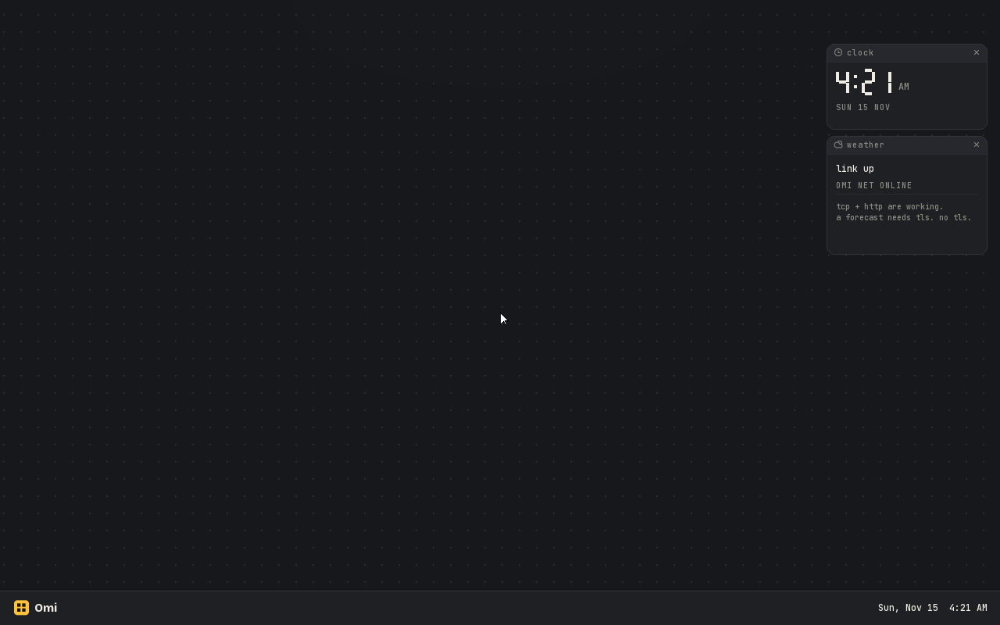

# Omi

Omi is a fork of [vib-OS](https://github.com/viralcode/vib-OS) — same custom 64-bit kernel,
same from-scratch userspace — with a different face and a few things the base tree does not
have: networking, sound, a browser, and a flat, paper-coloured shell.

Everything here is x86_64 and lives in [`vib-os-x86_64/`](vib-os-x86_64/). The ARM/RISC-V trees
are untouched upstream code.



**Landing page:** [`docs/index.html`](docs/index.html) — the pitch, the stack, and six unretouched
1280×800 captures taken in QEMU. It is static HTML with no javascript; open the file directly or
serve the folder.

## What Omi adds

**Shell.** Flat, shadowless window chrome — cream paper, a `#FFC23D` accent,
hairline borders, Bricolage Grotesque + JetBrains Mono. Midnight is the boot appearance. A
Windows-style taskbar sits at the bottom with a start menu; the Omi mark is the start button.
Iconography is [Remix Icon](https://icon-sets.iconify.design/ri/), baked to bitmaps by
`vib-os-x86_64/tools/gen_ri_icons.py` so the kernel needs no font renderer for them.
Limine boots straight through — `timeout: 0`, no menu, no countdown.

**Networking.** A real stack, no shims: e1000 driver, ARP, IPv4, ICMP, UDP, DHCP, DNS and TCP,
with an HTTP/1.1 client on top (`kernel/net/`). The network widget reports link state and whether
`tcp + http` actually answer; Omi Net uses the same stack for pages.

**Omi Net.** A browser window with a typed address bar, tabs, scrolling and a status strip
(`http 200 · lines · scroll`). Pages are fetched over TCP and rendered by Gumbo plus a CSS box model
of our own (`kernel/gui/omiweb.c`), with stb_truetype text, decoded images, clickable links and
tables. HTTPS works: TLS 1.2 through BearSSL with a pinned root bundle (`kernel/net/roots.c`).

**Processes.** GDT + TSS, a 100 Hz PIT, and a cooperative round-robin scheduler over eight task
slots with 16 KB kernel stacks (`kernel/kernel_task.c`). The task manager window lists every task
with state, ticks, switches and a CPU-share bar, and is reachable with Ctrl+Alt+Del or from the
taskbar's right-click menu. There is still no ring 3, no page tables, no syscalls and no ELF
loader — see the README's honesty section.

**Sound.** Intel HDA output with a streaming API (`hda_stream_start/write/free/stop`) and an MP3
decoder (minimp3) in `kernel/media/`. The media player streams the track from disk while it plays,
shows elapsed/total time and a progress bar, and does not stall the compositor while decoding.

**Apps.** Calculator, notepad, media player, Omi Net, plus toggleable clock / weather / network
widgets.

## Building

```sh
sudo apt install build-essential xorriso mtools gcc nasm
cd vib-os-x86_64
make            # -> omi.iso
```

Run it:

```sh
qemu-system-x86_64 -m 512 -cdrom omi.iso -boot d -vga std \
  -netdev user,id=n0 -device e1000,netdev=n0 \
  -audiodev sdl,id=snd -device intel-hda -device hda-output,audiodev=snd
```

`-device e1000` is what gives Omi a network (QEMU user-mode networking hands out `10.0.2.15`).
`hda-output` is correct for most real machines; `hda-duplex` only if you have a capture endpoint
(most desktops do not, and duplex then fails at init).

## What does not work yet

- **No TLS.** HTTPS is refused, not silently broken. A weather forecast needs TLS, so the weather
  widget reports connectivity rather than a forecast.
- **No microphone capture** on real hardware — no capture endpoint is exposed by most onboard HDA.
- **No multi-process userspace.** Apps are kernel-resident windows, as in upstream vib-OS.
- **Slow HTTP origins look slow.** Connect timeouts are 1.5 s → 3.5 s → 5 s across three attempts
  (fresh source port each time), so a site that takes 11 s to answer will fail rather than hang.

## Sample media

`vib-os-x86_64/assets/sample.{mp3,mp4}` are generated placeholders (ffmpeg sine tones and a test
pattern), committed so the media player has something to open. Swap in your own files and rebuild.

## Upstream

Forked from [viralcode/vib-OS](https://github.com/viralcode/vib-OS) at `73b6429`. Changes are
confined to `vib-os-x86_64/` and are visible as a single commit on top of upstream — see
`git log --stat` or the compare view against `viralcode/vib-OS:main`.