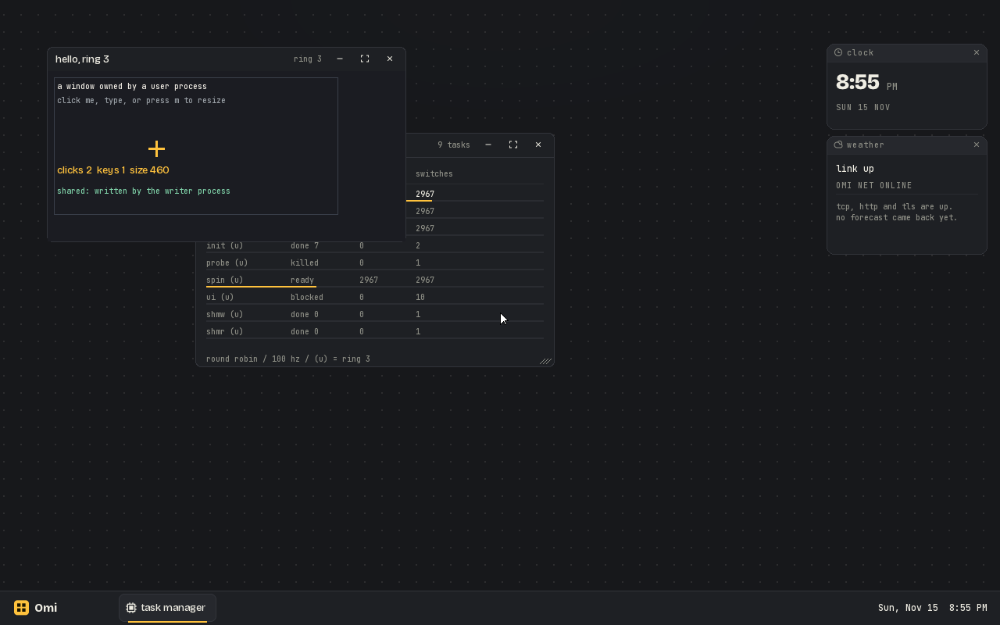
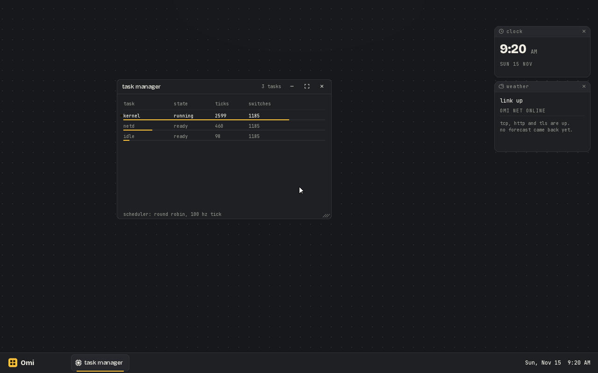

# Omi

An operating system you boot from a USB stick: it draws its own desktop, fetches pages over a
TCP/IP stack and a TLS stack it implements itself, renders them with its own CSS engine, and runs
programs **in user mode** — each one in its own address space, preempted by the timer, talking to the
shell through syscalls.

Omi is a fork of [vib-OS](https://github.com/viralcode/vib-OS) — same custom 64-bit kernel, same
from-scratch userspace — with the network, the renderer, the shell, the sound, a preemptive scheduler
and a ring-3 process model added here.



**Landing page:** https://itzomii.github.io/Omi/ · **Bootable ISO:** [v0.2.0 release](https://github.com/ItzOmii/Omi/releases/tag/v0.2.0) — newer builds are on `main`.

## The shell

Flat, shadowless chrome in the spirit of a paper notebook: cream surfaces, an `#FFC23D` accent,
hairline borders, Bricolage Grotesque for display type and JetBrains Mono everywhere a number lives.
**Midnight is the boot appearance** — the captures here are the untouched default, not a theme demo.

- **Windows-style bottom taskbar.** The Omi mark at the bottom left is the start button; running
  apps appear as buttons beside it with an accent underline on the focused one; the clock and date
  sit at the right.
- **Widgets** live down the right edge — a clock, and a network card that reports what the stack
  actually did rather than a picture of a sun.
- **Windows resize, minimize, maximize and focus by click.** Built-in apps are structs in
  `kernel/gui/compositor.c`; ring-3 windows are placed by the kernel and may move and resize
  themselves.
- **Two ways into the task manager**, both Windows-shaped: `Ctrl+Alt+Del`, or right-click the
  taskbar and pick it from the menu. The chord is latched in the PS/2 driver and polled by the
  shell, so plain Delete still means backspace in a text field. The popup opens above the bar so the
  chrome never clips it.
- **The task manager tells the truth.** Per-task state (`running`, `ready`, `blocked`, `done`,
  `killed`), ticks, switches and a CPU-share bar, plus `(u)` on anything in ring 3. A process waiting
  for input shows `blocked` and stops costing cycles.
- **Icons** are the [Remix Icon](https://icon-sets.iconify.design/ri/) set, baked to bitmaps by
  `tools/gen_ri_icons.py` — the kernel needs no icon font and no SVG parser.
- **Instant boot.** Limine is configured with `timeout: 0` — no menu, no countdown.

## User mode

This is the part that changed most recently, and it is a real privilege boundary rather than a
simulation.

- **One PML4 per process.** The kernel's own page tables are copied in (so the kernel image and the
  direct map stay reachable at CPL 0, supervisor-only) and one slot is rebuilt for the program: its
  segments, a 32 KB stack, and nothing else. The framebuffer, the heap and the kernel text are all
  mapped — and all untouchable from ring 3.
- **`int 0x80` through a DPL-3 gate**, landing on the TSS `rsp0` stack. 18 syscalls: write, exit,
  yield, ticks, getpid, five for windows, one blocking wait, two for geometry, two for shared
  memory, two for the clipboard.
- **Programs are ELF files on the ISO**, not blobs in the kernel. `kernel/elf.c` validates and maps
  the `PT_LOAD` segments, gives `.bss` its zero pages, and `kernel/user/init.c` is built freestanding
  against its own linker script.
- **Preemptive scheduling.** Every suspended task is an interrupt frame — 15 registers, then
  `rip/cs/rflags` (plus `rsp/ss` from ring 3). IRQ0 preempts anything running at RPL 3 100 times a
  second; kernel tasks still leave the CPU at explicit yield points, which keeps the kernel
  single-threaded and lock-free. A user program cannot hog the machine, and a spinning one shows
  `ticks == switches` in the task manager because it never yields.
- **FPU state is per task.** `fxsave`/`fxrstor` around both the scheduler stubs and the syscall
  entry, because the kernel itself uses SSE — without it a process's live `xmm` values get shredded
  across a syscall.
- **A fault kills one process.** A user task that steps outside its window takes a `#PF`, gets
  `killed` in the task manager, and the desktop keeps running.

## The compositor as a server

A ring-3 process never touches a pixel buffer. It describes a window and the kernel draws it:

- `SYS_WIN_OPEN(title, w, h)` then one draw command per syscall — rectangle, frame, small text,
  large text — with **text copied out of user space at the boundary**, so the renderer only ever
  touches its own copies. Every shape is clipped to the client rect and every string truncated to
  fit, so a process cannot paint outside itself.
- **Input comes back as events**: `MOVE`, `DOWN`, `UP` (in client coordinates) and `KEY`, queued per
  window and delivered only to the focused one — the shell never sees keys meant for a process.
- **Sleeping, not spinning.** `SYS_WIN_WAIT` blocks the task until there is an event for it; the
  scheduler has a real `blocked` state and the process costs nothing while idle.
- **Shared memory between processes.** `SYS_SHM_GET` / `SYS_SHM_ATTACH` map the *same physical
  frames* into two address spaces; `SYS_CLIP_SET` / `SYS_CLIP_GET` is a one-slot text clipboard on
  top. Two processes were built to prove it: one writes, the other reads it back and prints it.

```
writer: wrote into shared slot 0
reader: sees "written by the writer process"
reader: clipboard says "written by the writer process"
[ring3] first syscall: cs=0x23  (cpl 3)
```

## Processes

- **GDT + TSS** installed by the kernel (Limine's descriptor table is not guaranteed to survive).
- **PIT at 100 Hz** drives IRQ0, which accrues per-task ticks and is the preemption timer.
- **Round-robin over 12 tasks** with 16 KB kernel stacks each, per-task CR3 and `rsp0`.
- **A task manager** that lists every task with state, ticks, switches and a CPU-share bar, plus a
  footer naming the scheduler and its tick rate.

## Networking

e1000 driver, ARP, IPv4/ICMP, UDP, DHCP, DNS, TCP, an HTTP/1.1 client and TLS 1.2, all in
`vib-os-x86_64/kernel/net/`. No lwIP, no vendored network stack, no POSIX sockets.

- **DNS** asks `8.8.8.8` first, falls back to the DHCP-provided resolver, then `8.8.4.4`.
- **TLS** is real, not a banner: BearSSL with a pinned root bundle (`net/roots.c`), which is why
  `https://` pages load and the serial log can say `tls=yes`.
- **Redirects are followed**, and the status strip reports the code it actually got.
- The stack is still **in the kernel**: a ring-3 process cannot open a socket yet, so the browser is
  the only thing that uses the network today.

```
[net] dhcp discover
[net] dhcp lease ip=10.0.2.15 mask=255.255.255.0 gw=10.0.2.2 dns=10.0.2.3
[dns] via 8.8.8.8
[net] http 200 len=577 tls=yes title="Example Domain"
```

## The renderer

**Omi Net** is a browser window with an address bar, tabs, scrolling and a status strip — and behind
it a real engine rather than a tag stripper:

- **HTML5** parsed by vendored Gumbo.
- **CSS layout of our own**: the box model (margin → border → padding → content), per-side borders,
  radii, shorthand, stylesheet rules and UA defaults — `kernel/gui/omiweb.c`.
- **Text** through stb_truetype with the real Bricolage Grotesque and JetBrains Mono faces.
- **Images** decoded system-wide by stb_image (PNG and JPEG), not just in the browser.
- **Links are clickable** and resolved against the page they came from; **tables get genuine
  per-column widths** from their own layout pass.

## The screens

| | |
|---|---|
|  |  |
| A window owned by a user process: crosshair where it was clicked, its own resize, and a line read out of shared memory another process wrote | The same process asleep: `ui (u) blocked`, zero ticks, woken only by input |
|  |  |
| The default desktop: midnight, dot grid, clock and link-state widgets | Tick accounting per task, with the scheduler named in the footer |

All captures are unretouched 1280×800 frames from the ISO, taken in QEMU with the e1000 and HDA
devices attached.

## Build and run

```sh
sudo apt install build-essential xorriso mtools gcc nasm
cd vib-os-x86_64
make                      # -> omi.iso, about 11 MB
```

```sh
qemu-system-x86_64 -m 512 -cdrom omi.iso -boot d -vga std \
  -netdev user,id=n0 -device e1000,netdev=n0 \
  -audiodev sdl,id=snd -device intel-hda -device hda-output,audiodev=snd
```

The `e1000` device is what gives Omi a network — QEMU user-mode networking hands out `10.0.2.15`.
`hda-output` is right for most real machines; `hda-duplex` only if you have a capture endpoint, which
most desktops do not expose.

To boot real hardware: `sudo dd if=omi.iso of=/dev/sdX bs=4M status=progress`.

## What does not work

- **No demand paging and no `mmap`.** A process's window is 1 MB, its stack 32 KB, and memory is
  handed out as fixed 4 KB frames from a static pool — there is no allocator over physical memory
  yet, which is what surfaces and any real application work need next.
- **No threads.** One task is one address space is one thread of control; `clone` does not exist.
- **No filesystem.** Programs are Limine boot modules matched by name, not files read from a disk.
- **The network is still kernel-only.** A ring-3 process cannot open a socket, so nothing but the
  in-kernel browser uses it.
- **One window per process**, six ring-3 windows at a time, 48 draw commands and 128 bytes of text
  per command. The wait has no timeout — only input or a close wakes a process.
- **No forecast.** The network widget reports link state honestly (`tcp, http and tls are up`) because
  no weather source is wired to it yet, and it will not invent a temperature.
- **No microphone capture.** Output works on real hardware; capture does not, because onboard HDA
  codecs usually expose no capture endpoint.

More detail, including the debugging that led to the current TCP timeouts, is in [OMI.md](OMI.md).

## Upstream

Forked from [viralcode/vib-OS](https://github.com/viralcode/vib-OS). Changes are confined to
`vib-os-x86_64/` and sit on top of upstream `main` — see the
[compare view](https://github.com/viralcode/vib-OS/compare/main...ItzOmii:main). Upstream's own
README is preserved as [UPSTREAM-README.md](UPSTREAM-README.md).

About 21,750 lines of the diff are ours; the rest is vendored Gumbo (HTML5 parsing), BearSSL (TLS),
stb_truetype, stb_image and minimp3, each kept in `kernel/lib/` or beside the code that uses it.
Sample media in `assets/` are generated placeholders (sine tones and a test pattern), not licensed
music. The license is upstream's; check their repository before reusing this commercially.