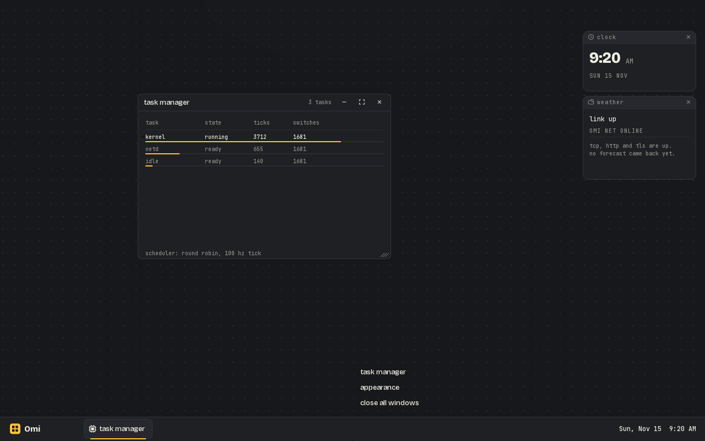
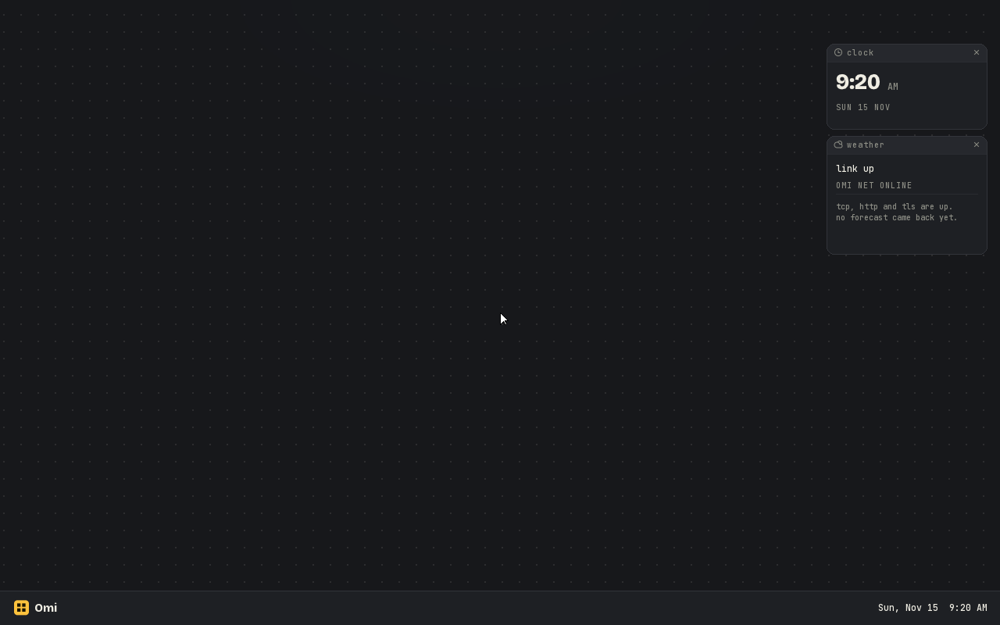
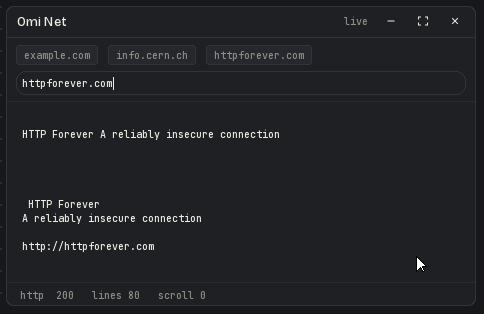

# Omi

An operating system you boot from a USB stick: it draws its own desktop, fetches pages over a
TCP/IP stack and a TLS stack it implements itself, renders them with its own CSS engine, and now
yields between processes on a timer.

Omi is a fork of [vib-OS](https://github.com/viralcode/vib-OS) — same custom 64-bit kernel, same
from-scratch userspace — with the network, the renderer, the shell, the sound and the first slice of
a process model added here.



**Landing page:** https://itzomii.github.io/Omi/ · **Bootable ISO:** [v0.2.0 release](https://github.com/ItzOmii/Omi/releases/tag/v0.2.0) — newer builds are on `main`.

## The shell

Flat, shadowless chrome in the spirit of a paper notebook: cream surfaces, an `#FFC23D` accent,
hairline borders, Bricolage Grotesque for display type and JetBrains Mono everywhere a number lives.
**Midnight is the boot appearance** — the capture above is the untouched default, not a theme demo.

- **Windows-style bottom taskbar.** The Omi mark at the bottom left is the start button; running
  apps appear as buttons beside it with an accent underline on the focused one; the clock and date
  sit at the right.
- **Widgets** live down the right edge — a clock, and a network card that reports what the stack
  actually did rather than a picture of a sun.
- **Windows resize, minimize, maximize and focus by click**, and every one of them is a struct plus
  a draw function in `kernel/gui/compositor.c`.
- **Two ways into the task manager**, both Windows-shaped: `Ctrl+Alt+Del`, or right-click the
  taskbar and pick it from the menu. The chord is latched in the PS/2 driver and polled by the
  shell, so plain Delete still means backspace in a text field. The popup opens above the bar so the
  chrome never clips it.
- **Icons** are the [Remix Icon](https://icon-sets.iconify.design/ri/) set, baked to bitmaps by
  `tools/gen_ri_icons.py` — the kernel needs no icon font and no SVG parser.
- **Instant boot.** Limine is configured with `timeout: 0` — no menu, no countdown.

## Networking

e1000 driver, ARP, IPv4/ICMP, UDP, DHCP, DNS, TCP, an HTTP/1.1 client and TLS 1.2, all in
`vib-os-x86_64/kernel/net/`. No lwIP, no vendored network stack, no POSIX sockets.

- **DNS** asks `8.8.8.8` first, falls back to the DHCP-provided resolver, then `8.8.4.4`.
- **TLS** is real, not a banner: BearSSL with a pinned root bundle (`net/roots.c`), which is why
  `https://` pages load and the serial log can say `tls=yes`.
- **Redirects are followed**, and the status strip reports the code it actually got.

```
[net] dhcp discover
[net] dhcp lease ip=10.0.2.15 mask=255.255.255.0 gw=10.0.2.2 dns=10.0.2.3
[dns] via 8.8.8.8
[net] http 200 len=577 tls=yes title="Example Domain"
```

## The renderer

**Omi Net** is a browser window with an address bar, tabs, scrolling and a status strip — and behind
it a real engine rather than a tag stripper:

- **HTML5** parsed by vendored Gumbo.
- **CSS layout of our own**: the box model (margin → border → padding → content), per-side borders,
  radii, shorthand, stylesheet rules and UA defaults — `kernel/gui/omiweb.c`.
- **Text** through stb_truetype with the real Bricolage Grotesque and JetBrains Mono faces.
- **Images** decoded system-wide by stb_image (PNG and JPEG), not just in the browser.
- **Links are clickable** and resolved against the page they came from; **tables get genuine
  per-column widths** from their own layout pass.

## Processes — the first slice

The kernel now has a task layer instead of one endless draw loop:

- **GDT + TSS** installed by the kernel (Limine's descriptor table is not guaranteed to survive).
- **PIT at 100 Hz** drives IRQ0, which accrues per-task ticks.
- **Round-robin scheduling** over up to 8 tasks with 16 KB kernel stacks; a pure-assembly context
  switch swaps six callee-saved registers and the stack pointer.
- **A task manager** that lists every task with state, ticks, switches and a CPU-share bar, plus a
  footer naming the scheduler and its tick rate.

This is a deliberate first step, and it is honest about where it stops: **cooperative** switching
(tasks hand over at `task_yield`, nothing is preempted mid-instruction), **no ring 3**, **no page
tables**, **no syscalls**, **no ELF loader**, and no FPU/SSE state save yet. Apps are still windows in
the kernel; the scheduler currently runs the compositor plus two worker tasks that do real work and
yield, which is what makes the numbers in that window move.

## The screens

| | |
|---|---|
|  |  |
| The default desktop: midnight, dot grid, clock and link-state widgets | Task manager: real tick accounting per task |
|  |  |
| Right-click the bar: task manager, appearance, close all windows | Omi Net over TLS, laid out by our own CSS engine |

All captures are unretouched 1280×800 frames from the ISO, taken in QEMU with the e1000 and HDA
devices attached.

## Build and run

```sh
sudo apt install build-essential xorriso mtools gcc nasm
cd vib-os-x86_64
make                      # -> omi.iso, about 11 MB
```

```sh
qemu-system-x86_64 -m 512 -cdrom omi.iso -boot d -vga std \
  -netdev user,id=n0 -device e1000,netdev=n0 \
  -audiodev sdl,id=snd -device intel-hda -device hda-output,audiodev=snd
```

The `e1000` device is what gives Omi a network — QEMU user-mode networking hands out `10.0.2.15`.
`hda-output` is right for most real machines; `hda-duplex` only if you have a capture endpoint, which
most desktops do not expose.

To boot real hardware: `sudo dd if=omi.iso of=/dev/sdX bs=4M status=progress`.

## What does not work

- **No user mode.** Everything runs in ring 0 in one address space: no page tables, no syscalls, no
  ELF loader, so a bad pointer in an app takes the whole shell with it. That is the next slab of
  work, not an oversight.
- **Scheduling is cooperative.** The timer accounts for time but does not force a switch, and there
  is no FPU/SSE state save yet — both have to land before anything runs in user space.
- **No forecast.** The network widget reports link state honestly (`tcp, http and tls are up`) because
  no weather source is wired to it yet, and it will not invent a temperature.
- **No microphone capture.** Output works on real hardware; capture does not, because onboard HDA
  codecs usually expose no capture endpoint.

More detail, including the debugging that led to the current TCP timeouts, is in [OMI.md](OMI.md).

## Upstream

Forked from [viralcode/vib-OS](https://github.com/viralcode/vib-OS). Changes are confined to
`vib-os-x86_64/` and sit on top of upstream `main` — see the
[compare view](https://github.com/viralcode/vib-OS/compare/main...ItzOmii:main). Upstream's own
README is preserved as [UPSTREAM-README.md](UPSTREAM-README.md).

About 17,600 lines of the diff are ours; the rest is vendored Gumbo (HTML5 parsing), BearSSL (TLS),
stb_truetype, stb_image and minimp3, each kept in `kernel/lib/` or beside the code that uses it.
Sample media in `assets/` are generated placeholders (sine tones and a test pattern), not licensed
music. The license is upstream's; check their repository before reusing this commercially.