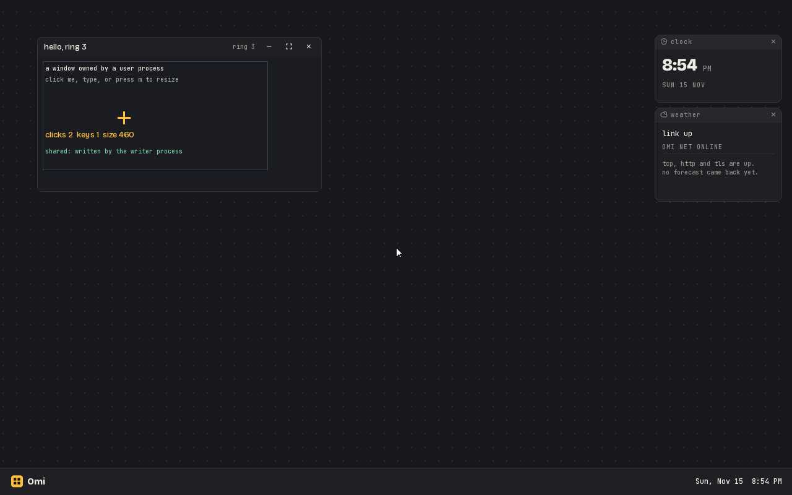

# Omi

An operating system you boot from a USB stick: it draws its own desktop, fetches pages over a
TCP/IP stack and a TLS stack it implements itself, renders them with its own CSS engine, and runs
programs **in user mode** — each one in its own address space, preempted by the timer, talking to the
shell through syscalls.

Omi is a fork of [vib-OS](https://github.com/viralcode/vib-OS) — same custom 64-bit kernel, same
from-scratch userspace — with the network, the renderer, the shell, the sound, a preemptive scheduler
and a ring-3 process model added here.


## The goal

Not "an operating system that can display a web page" — **an operating system a real browser could
eventually run on natively**. The target is Chromium's own processes: renderer, network service,
compositor, utility processes, thousands of threads, its own allocator, its own IPC. No bundled
browser, no Chrome OS userland, and no POSIX pretence where the semantics are missing.

That goal is a checklist, and the checklist is the roadmap. A browser needs an address space it can
grow at runtime, threads with real synchronisation, file descriptors that mean one thing, sockets
several at a time, readiness notification instead of polling, dynamic linking, and TLS from user
mode. Omi now has all but the last one: programs run as real musl binaries out of files, `fork` is
copy-on-write, `poll` reports readiness, and a position-independent program linked against a shared
object runs under musl's own `ld.so` - the kernel loads two images and hands over.

| What a browser needs | State |
|---|---|
| Physical page allocator, demand paging, `vm_alloc`/`vm_free` | **done** |
| One address space per process, ring-3 isolation, `int 0x80` | **done** |
| Preemptive CPL-3 scheduling, per-task FPU state | **done** |
| Threads + futexes over refcounted address spaces | **done** |
| Descriptors: `fd → ofile → rfile`, `dup`, shared offsets | **done** |
| Files: RAM-backed VFS, programs as ELF on the ISO | **done** |
| Sockets as descriptors, several connections at once | **done** |
| `poll`/readiness over several descriptors, blocking and non-blocking I/O | **done** |
| `fork`, copy-on-write, `wait4`, signals | **done** |
| Boot modules openable as files, file-backed `mmap` | **done** |
| Dynamic linking: `ld.so`, `PT_INTERP`, `ET_DYN` | **done** |
| `execve`: a program replaces its own image, argv and descriptors intact | **done** |
| TCP teardown (FIN/RST/`TIME_WAIT`), retransmission | not yet |
| UDP sockets, `bind`/`listen`/`accept` | not yet |
| TLS from user mode | not yet |

## How it got here

Every step was proven by running it, and each one is now a permanent boot test.

- **The shell** — a compositor, a taskbar and widgets, drawn by the kernel, booting instantly under
  Limine. This is what made the machine usable enough to test anything else on.
- **The network** — e1000, ARP, IPv4/ICMP, DHCP, UDP, DNS, TCP, HTTP/1.1 and TLS 1.2, then a CSS
  engine and Omi Net on top of it. The in-kernel browser proves the stack end to end.
- **User mode** — one PML4 per process, a DPL-3 `int 0x80` gate, ELF programs loaded from the ISO,
  and IRQ0 preempting ring 3. A fault kills one process instead of the desktop.
- **Memory** — a physical page allocator and demand paging, so a process can ask for pages with
  `vm_alloc` instead of being handed a fixed window.
- **Threads and descriptors** — shared address spaces with futex wait/wake, and a three-layer
  descriptor table whose `open`-file description is what `dup` shares and `close` reference-counts.
- **An independent userspace build** — `userland/` compiles its own ELFs with its own linker script
  and its own syscall numbers, sharing no header with the kernel. On its first run it found two
  kernel bugs that no in-kernel demo could: a page-table lookup that returned the table instead of
  the entry, and `open()` returning `-EFAULT` for a path near the top of the user window.
- **Sockets as descriptors** — `socket`/`connect`/`send`/`recv`/`resolve` on the same descriptor
  path as files, and then per-connection TCP state so two programs can be online at once.

**Landing page:** https://itzomii.github.io/Omi/ · **Bootable ISO:** [v0.2.0 release](https://github.com/ItzOmii/Omi/releases/tag/v0.2.0) — newer builds are on `main`.

## The shell

Flat, shadowless chrome in the spirit of a paper notebook: cream surfaces, an `#FFC23D` accent,
hairline borders, Bricolage Grotesque for display type and JetBrains Mono everywhere a number lives.
**Midnight is the boot appearance** — the captures here are the untouched default, not a theme demo.

- **Windows-style bottom taskbar.** The Omi mark at the bottom left is the start button; running
  apps appear as buttons beside it with an accent underline on the focused one; the clock and date
  sit at the right.
- **Widgets** live down the right edge — a clock, and a network card that reports what the stack
  actually did rather than a picture of a sun.
- **Windows resize, minimize, maximize and focus by click.** Built-in apps are structs in
  `kernel/gui/compositor.c`; ring-3 windows are placed by the kernel and may move and resize
  themselves.
- **Two ways into the task manager**, both Windows-shaped: `Ctrl+Alt+Del`, or right-click the
  taskbar and pick it from the menu. The chord is latched in the PS/2 driver and polled by the
  shell, so plain Delete still means backspace in a text field. The popup opens above the bar so the
  chrome never clips it.
- **The task manager tells the truth.** Per-task state (`running`, `ready`, `blocked`, `done`,
  `killed`), ticks, switches and a CPU-share bar, plus `(u)` on anything in ring 3. A process waiting
  for input shows `blocked` and stops costing cycles.
- **Icons** are the [Remix Icon](https://icon-sets.iconify.design/ri/) set, baked to bitmaps by
  `tools/gen_ri_icons.py` — the kernel needs no icon font and no SVG parser.
- **Instant boot.** Limine is configured with `timeout: 0` — no menu, no countdown.

## User mode

This is the part that changed most recently, and it is a real privilege boundary rather than a
simulation.

- **One PML4 per process.** The kernel's own page tables are copied in (so the kernel image and the
  direct map stay reachable at CPL 0, supervisor-only) and one slot is rebuilt for the program: its
  segments, a 32 KB stack, and nothing else. The framebuffer, the heap and the kernel text are all
  mapped — and all untouchable from ring 3.
- **`int 0x80` through a DPL-3 gate**, landing on the TSS `rsp0` stack. 34 syscalls: console and
  process control, the window protocol, shared memory and clipboard, `vm_alloc`/`vm_free`, threads
  and futexes, the descriptor calls (`open`/`read`/`lseek`/`close`/`dup`/`pipe`), five for sockets,
  and `poll` for readiness across several descriptors.
  Numbers and semantics live in `kernel/include/ring3.h`; `userland/` carries its own copy. A second
  table answers Linux numbers (`int 0x80` and `syscall`) for libc: 27 checks run against it at boot.
- **Programs are ELF files on the ISO**, not blobs in the kernel. `kernel/elf.c` validates and maps
  the `PT_LOAD` segments, gives `.bss` its zero pages, and `kernel/user/init.c` is built freestanding
  against its own linker script.
- **Preemptive scheduling.** Every suspended task is an interrupt frame — 15 registers, then
  `rip/cs/rflags` (plus `rsp/ss` from ring 3). IRQ0 preempts anything running at RPL 3 100 times a
  second; kernel tasks still leave the CPU at explicit yield points, which keeps the kernel
  single-threaded and lock-free. A user program cannot hog the machine, and a spinning one shows
  `ticks == switches` in the task manager because it never yields.
- **FPU state is per task.** `fxsave`/`fxrstor` around both the scheduler stubs and the syscall
  entry, because the kernel itself uses SSE — without it a process's live `xmm` values get shredded
  across a syscall.
- **A fault kills one process.** A user task that steps outside its window takes a `#PF`, gets
  `killed` in the task manager, and the desktop keeps running.

## The compositor as a server

A ring-3 process never touches a pixel buffer. It describes a window and the kernel draws it:

- `SYS_WIN_OPEN(title, w, h)` then one draw command per syscall — rectangle, frame, small text,
  large text — with **text copied out of user space at the boundary**, so the renderer only ever
  touches its own copies. Every shape is clipped to the client rect and every string truncated to
  fit, so a process cannot paint outside itself.
- **Input comes back as events**: `MOVE`, `DOWN`, `UP` (in client coordinates) and `KEY`, queued per
  window and delivered only to the focused one — the shell never sees keys meant for a process.
- **Sleeping, not spinning.** `SYS_WIN_WAIT` blocks the task until there is an event for it; the
  scheduler has a real `blocked` state and the process costs nothing while idle.
- **Shared memory between processes.** `SYS_SHM_GET` / `SYS_SHM_ATTACH` map the *same physical
  frames* into two address spaces; `SYS_CLIP_SET` / `SYS_CLIP_GET` is a one-slot text clipboard on
  top. Two processes were built to prove it: one writes, the other reads it back and prints it.

```
writer: wrote into shared slot 0
reader: sees "written by the writer process"
reader: clipboard says "written by the writer process"
[ring3] first syscall: cs=0x23  (cpl 3)
```

## Processes

- **GDT + TSS** installed by the kernel (Limine's descriptor table is not guaranteed to survive).
- **PIT at 100 Hz** drives IRQ0, which accrues per-task ticks and is the preemption timer.
- **Round-robin over 32 task slots** with 16 KB kernel stacks each, per-task CR3 and `rsp0`. A full
  table says `[task] no free slot (TASK_MAX) for <name>` rather than failing silently, because a
  failed spawn impersonating a broken futex cost a debugging session once already.
- **A task manager** that lists every task with state, ticks, switches and a CPU-share bar, plus a
  footer naming the scheduler and its tick rate.

## Networking

e1000 driver, ARP, IPv4/ICMP, UDP, DHCP, DNS, TCP, an HTTP/1.1 client and TLS 1.2, all in
`vib-os-x86_64/kernel/net/`. No lwIP, no vendored stack, no POSIX socket library — the descriptor
semantics are ours as well.

- **DNS** asks `8.8.8.8` first, falls back to the DHCP-provided resolver, then `8.8.4.4`.
- **TLS** is real, not a banner: BearSSL with a pinned root bundle (`net/roots.c`), which is why
  `https://` pages load and the serial log can say `tls=yes`.
- **Redirects are followed**, and the status strip reports the code it actually got.
- **DNS and TCP are reachable from user mode** — `SYS_RESOLVE`, then `socket`/`connect`/`send`/
  `recv` on ordinary descriptors.

```
[net] dhcp discover
[net] dhcp lease ip=10.0.2.15 mask=255.255.255.0 gw=10.0.2.2 dns=10.0.2.3
[dns] via 8.8.8.8
[net] http 200 len=577 tls=yes title="Example Domain"
```

### Sockets are descriptors

`socket()` returns a fourth kind of `ofile_t` rather than a parallel mechanism, so `read`/`write`/
`close` on a socket take the same path as on a file and a program cannot tell the difference at the
syscall:

```
process fd table → ofile_t → rfile_t    (file: offset, RAM pages)
                          → tcp_conn_t  (socket: one connection)
                          → console
```

The connection belongs to the open file description, so `dup()` shares it, closing one descriptor
leaves it alive, and only the final close tears it down. `close()` on an already-closed connection
logs `DOUBLE-CLOSE` instead of happening twice quietly.

### Connections are objects, not globals

`tcp_conn_t` carries one connection's ports, sequence numbers, state and receive buffer. Eight of
them live in `tcp.c`, and every inbound segment is demultiplexed by 4-tuple to the connection that
owns it — so a socket that is not currently reading still collects its bytes. What is still global is
stated honestly: the interface configuration and the single e1000 receive queue, one poller at a time.

The proof is two independently compiled programs online at once, plus two real hostnames:

```
[tcp] conn up 0 port 52576 -> 10.0.2.2:8899
[tcp] conn up 1 port 61431 -> 10.0.2.2:8899      ← both open at the same time
httpget: using dup fd 4
httpget: 428 bytes   ALPHA ALPHA …               exit 0
httpget: 428 bytes   BRAVO BRAVO …               exit 0
httpget: example.com is 172.66.147.243           892 bytes   exit 0
httpget: example.org is 104.20.26.136            921 bytes   exit 0
```

Four clients run at every boot: two against a local server, one of which duplicates its socket and
closes the original before finishing the transfer (the lifetime rule), and two that resolve different
hostnames and fetch different pages with no mixing.

Two lessons from getting that green, both now guarded:

- **A ping must not lose a download.** The boot-time ICMP loop polled the NIC and discarded every
  frame that was not its own reply, including another connection's response — the server logged
  `SENT`, the client logged `recv: timed out`. Anything that does not own a frame now hands it to
  `tcp_input()`.
- **One poller at a time.** `rx_busy` serialises the receive path; the loser does nothing, because
  the winner dispatches for everybody.

Honest limits: `poll()` waits on up to 16 descriptors and one process at a time polls its own; there
is no `bind`/`listen`/`accept`, no UDP socket API and no retransmission or `TIME_WAIT`. DNS resolves
one query at a time on purpose: every query leaves from the same local port, so two in flight would
read each other's replies and both would time out. Per-query ports and a UDP receive queue come with
UDP sockets.

## Files and descriptors

- **Three layers.** The process descriptor table (16 entries) points at `ofile_t` (64, reference
  counted, carries the flags and the socket's connection), which points at an `rfile_t` (offset plus
  RAM pages). Threads share their process's table, so two threads see the same descriptors; `dup`
  shares the offset by design, and a second `open` does not.
- **A RAM-backed VFS.** Three files seeded at boot (`/hello.txt`, `/readme.txt`, `/motd`), 24 file
  slots, with `open`, `read`, `write`, `lseek`, `close`, `dup` and real error codes: `-ENOENT`,
  `-ENOTDIR`, `-EMFILE`, `-EBADF`. Every Limine module is also registered as a read-only file under
  its boot path, so a program can `open("/lib/libgreet.so")` and read the same bytes the kernel
  loaded; writing one returns `-EROFS`, because those bytes are the boot image, not storage. A
  16-check suite runs at every boot, including one that reads into a freshly allocated page.
- **Mappings come from a file or from nowhere.** `mmap` of a file-backed region copies the page from
  the module on first touch, `MAP_FIXED` takes the addresses it is given, and everything releases
  through the same copy-on-write refcount bank as a forked page - so nothing has to be special-cased
  when the process exits.
- **Programs are still spawned from a hardcoded list**, matched by module name rather than executed
  from a path - a loaded module is not a run one. The bytes are now readable through the VFS; `exec`
  taking a path is still ahead. `userland/` builds them independently, with its own linker script and
  its own syscall numbers, and shares no header with the kernel.

## The renderer

**Omi Net** is a browser window with an address bar, tabs, scrolling and a status strip — and behind
it a real engine rather than a tag stripper:

- **HTML5** parsed by vendored Gumbo.
- **CSS layout of our own**: the box model (margin → border → padding → content), per-side borders,
  radii, shorthand, stylesheet rules and UA defaults — `kernel/gui/omiweb.c`.
- **Text** through stb_truetype with the real Bricolage Grotesque and JetBrains Mono faces.
- **Images** decoded system-wide by stb_image (PNG and JPEG), not just in the browser.
- **Links are clickable** and resolved against the page they came from; **tables get genuine
  per-column widths** from their own layout pass.

## The screens

| | |
|---|---|
|  |  |
| A window owned by a user process: crosshair where it was clicked, its own resize, and a line read out of shared memory another process wrote | The same process asleep: `ui (u) blocked`, zero ticks, woken only by input |
|  |  |
| The default desktop: midnight, dot grid, clock and link-state widgets | Tick accounting per task, with the scheduler named in the footer |

All captures are unretouched 1280×800 frames from QEMU boots of this tree with the e1000 and HDA
devices attached.

## Build and run

```sh
sudo apt install build-essential xorriso mtools gcc nasm
cd vib-os-x86_64
make                      # -> omi.iso, about 11 MB
```

```sh
qemu-system-x86_64 -m 512 -cdrom omi.iso -boot d -vga std \
  -netdev user,id=n0 -device e1000,netdev=n0 \
  -audiodev sdl,id=snd -device intel-hda -device hda-output,audiodev=snd
```

The `e1000` device is what gives Omi a network — QEMU user-mode networking hands out `10.0.2.15`.
`hda-output` is right for most real machines; `hda-duplex` only if you have a capture endpoint, which
most desktops do not expose.

To boot real hardware: `sudo dd if=omi.iso of=/dev/sdX bs=4M status=progress`.

## What does not work

- **No TCP teardown or retransmission.** A connection ends with a single FIN and nothing handles
  `RST`, `TIME_WAIT` or a lost segment; a dropped packet is a dropped response.
- **No server sockets.** No `bind`, `listen` or `accept`, and no UDP socket interface — DNS is used
  inside the kernel, not by programs.
- **TLS and HTTP are kernel-side.** A program can have a socket; it cannot yet get `https://`, because
  BearSSL is linked into the kernel and there is no userspace TLS library.
- **Dynamic linking works, with sharp edges.** A PIE that names an interpreter runs: the kernel maps
  the program at the base of the user window and `ld.so` at +1 MB in the same space, passes the
  program's phdrs and entry in the auxv, and starts the interpreter. What is missing is around it —
  `MAP_SHARED` over a file is `-ENOSYS` (there is no write-back path), the interpreter's address is a
  kernel constant, and a range painted `PROT_NONE` loses its bytes when it is given access again,
  where Linux would preserve them.
- **The VFS is RAM only** — three files seeded at boot, 24 slots, no disk and no directories below the
  root. Boot modules are readable as files (read-only, `-EROFS` on write) and a file can be mapped,
  and a program can now replace its own image with one of them (`execve`, with argv and its
  descriptors carried across), so the spawn list is a starting point rather than the only way in.
  What is still missing is something to *ask*: no shell, no `PATH`, and no environment for one to
  read.
- **One window per process**, six ring-3 windows at a time, 48 draw commands and 128 bytes of text
  per command. The wait has no timeout — only input or a close wakes a process.
- **No forecast.** The network widget reports link state honestly (`tcp, http and tls are up`) because
  no weather source is wired to it yet, and it will not invent a temperature.
- **No microphone capture.** Output works on real hardware; capture does not, because onboard HDA
  codecs usually expose no capture endpoint.

More detail, including the debugging that led to the current TCP timeouts, is in [OMI.md](OMI.md).

## Upstream

Forked from [viralcode/vib-OS](https://github.com/viralcode/vib-OS). Changes are confined to
`vib-os-x86_64/` and sit on top of upstream `main` — see the
[compare view](https://github.com/viralcode/vib-OS/compare/main...ItzOmii:main). Upstream's own
README is preserved as [UPSTREAM-README.md](UPSTREAM-README.md).

The fork's diff against upstream is about 146,000 added lines across `vib-os-x86_64/` — that count
includes vendored Gumbo (HTML5 parsing), BearSSL (TLS), stb_truetype, stb_image and minimp3, each kept
in `kernel/lib/` or beside the code that uses it, plus generated icon and font atlases.
Sample media in `assets/` are generated placeholders (sine tones and a test pattern), not licensed
music. The license is upstream's; check their repository before reusing this commercially.