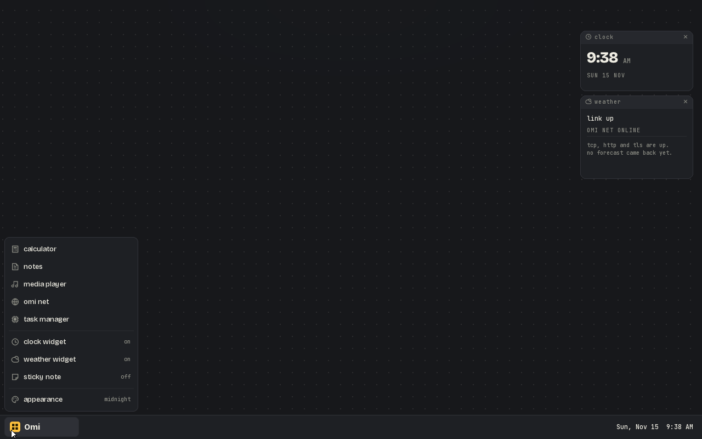
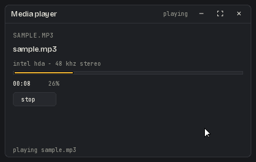
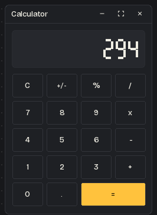
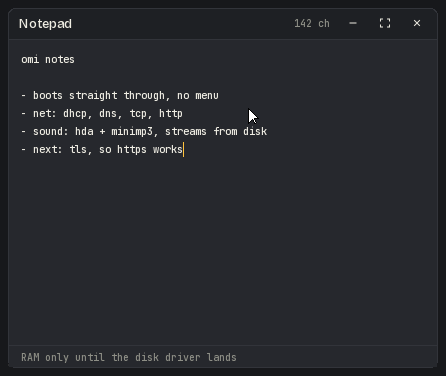

# Omi

A small operating system you boot from a USB stick: it draws its own desktop, fetches web pages
over a TCP/IP stack it implements itself, and plays MP3s straight off the boot medium.

Omi is a fork of [vib-OS](https://github.com/viralcode/vib-OS) — same custom 64-bit kernel, same
from-scratch userspace — with the network, the sound, the browser and the shell added here.


**Landing page:** https://itzomii.github.io/Omi/ · **Bootable ISO:** [v0.2.0 release](https://github.com/ItzOmii/Omi/releases/tag/v0.2.0) (9.5 MB)

## What Omi adds

- **Networking from the wire up.** e1000 driver, ARP, IPv4/ICMP, UDP, DHCP, DNS, TCP and an
  HTTP/1.1 client in `vib-os-x86_64/kernel/net/`. No lwIP, no POSIX sockets, no vendored stack.
- **Omi Net.** A browser window with bookmarks, a typed address bar, scrolling and a status strip.
  Pages come off a real socket and are rendered by a tag stripper that wraps to a width measured
  from the font. HTTP only — there is no TLS in the kernel.
- **Sound.** Intel HDA streaming output plus a minimp3 decoder; the media player streams from disk
  while it plays instead of buffering the whole track.
- **The shell.** Flat, shadowless chrome — cream paper, a `#FFC23D` accent, hairline borders.
  Midnight is the boot appearance. Windows-style bottom taskbar with a start menu; the Omi mark is
  the start button. Icons are the [Remix Icon](https://icon-sets.iconify.design/ri/) set, baked to
  bitmaps by `tools/gen_ri_icons.py` so the kernel needs no icon font.
- **Instant boot.** Limine is configured with `timeout: 0` — no menu, no countdown.

## The screens

| | |
|---|---|
|  |  |
| The shell: start menu, taskbar, widgets | Media player: minimp3 → Intel HDA |
|  |  |
| Calculator | Notepad |

All four are unretouched 1280×800 captures from the ISO, taken in QEMU with the e1000 and HDA
devices attached.

## Build and run

```sh
sudo apt install build-essential xorriso mtools gcc nasm
cd vib-os-x86_64
make                      # -> omi.iso
```

```sh
qemu-system-x86_64 -m 512 -cdrom omi.iso -boot d -vga std \
  -netdev user,id=n0 -device e1000,netdev=n0 \
  -audiodev sdl,id=snd -device intel-hda -device hda-output,audiodev=snd
```

The `e1000` device is what gives Omi a network — QEMU user-mode networking hands out `10.0.2.15`.
`hda-output` is right for most real machines; `hda-duplex` only if you have a capture endpoint,
which most desktops do not expose.

To boot real hardware: `sudo dd if=omi.iso of=/dev/sdX bs=4M status=progress`.

## What does not work

- **No TLS.** HTTPS hosts are refused up front rather than failing mysteriously, so no weather
  forecast either — the widget reports link state instead.
- **No microphone capture.** Output works on real hardware; capture does not, because onboard HDA
  codecs usually expose no capture endpoint.
- **No processes.** Apps are kernel-resident windows, exactly as upstream. One address space means
  one bug can take the shell down.

More detail, including the debugging that led to the current TCP timeouts, is in [OMI.md](OMI.md).

## Upstream

Forked from [viralcode/vib-OS](https://github.com/viralcode/vib-OS). Changes are confined to
`vib-os-x86_64/` and sit on top of upstream `main` — see the
[compare view](https://github.com/viralcode/vib-OS/compare/main...ItzOmii:main). Upstream's own
README is preserved as [UPSTREAM-README.md](UPSTREAM-README.md).

Sample media in `assets/` are generated placeholders (sine tones and a test pattern), not licensed
music. The license is upstream's; check their repository before reusing this commercially.