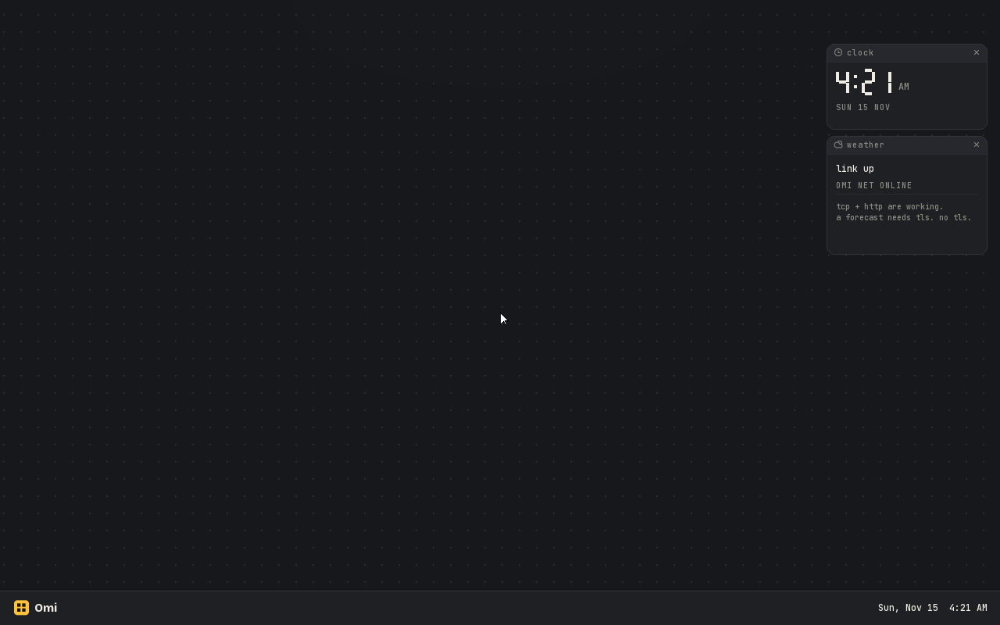

# Omi

An operating system that boots from a USB stick and runs programs in ring 3 with a real libc:
monolithic x86_64 kernel, its own drivers, its own TCP/IP and TLS, its own HTML/CSS engine, its own
compositor. No Linux underneath.

Forked from [vib-OS](https://github.com/viralcode/vib-OS), which supplied the UEFI entry, the
framebuffer and a first window manager. Everything below — processes, networking, TLS, surfaces,
the browser, audio, a disk — happened here.

**x86_64 only.** There is one kernel in this repository, and this is it.



By the numbers, measured from the tree (`find kernel -name '*.c'` and so on, vendored directories
counted separately): **35,743 lines** of first-party kernel C (plus **18,036** lines of its headers),
**11,746 lines** of user-mode C and C++, **103,958 lines** of vendored BearSSL and Gumbo, **101,195
lines** of vendored audio decoders in `kernel/media/`, and **59 native syscalls** in front of the Linux
ABI, which covers 55 Linux call numbers. A verification boot prints **398 `ok` lines** across 34 suites in the
serial log - a couple of those checks talk to the public internet, and when it refuses them they print
a skip instead of a failure, which is why the count moves by a few lines from one boot to the next.

**Starting here?** `docs/repo-overview.md` is the whole repository in one file: the map, what each
subsystem does, what changed and in what order, and the stage-by-stage ledger against
`docs/chromium-roadmap.md`.

---

## The shell

**Processes are real.** Each program gets its own address space with a 4 GB window, page tables
built on demand (so an empty 4 GB window costs nothing to create), copy-on-write `fork`, `execve`,
and timer preemption. A process that faults on unmapped memory dies alone.

**Windows are surfaces.** A ring-3 program asks for a window and a surface, maps it, writes
`0x00RRGGBB` words straight into it, and presents a damage rectangle. Eight surfaces exist at once,
16 MB of address space each, up to 1920×1200, and frames are allocated only for the pixels a
surface actually has — a 440×360 window costs 634 KB, not a whole slot. Sixteen windows are open at
once. A client that draws past its own surface faults instead of scribbling on its neighbour's
pixels, because everything past the last whole page is deliberately left unmapped.

**The desktop is drawn by the kernel.** Compositor, taskbar, dock, wallpapers decoded from JPEG at
boot, and the shell apps (calculator, notes, media player, file manager, task manager). Omi Net is
not one of them: it is a ring-3 process that opens a window and does its own fetching, parsing and
layout.

**The tray reports the machine, not a picture of it.** Network and audio sit at the right end of
the bar, left of the clock, in the order Windows has used for twenty years so a hand goes to the
right place without reading. Both glyphs are status: the speaker becomes the struck-through face
when the DAC is muted, the network one when DHCP has produced no address. Clicking either opens a
flyout above the bar — a vertical slider that writes the codec's gain register through
`audio_volume_set`, and a panel that names the link, says whether it holds an address, and prints
the address and gateway it holds. Nothing in either panel is cached: every frame re-reads
`audio_muted()` and `net_get()->valid`.

**That is the part that has to change**, and it is the first item in the Chromium section below:
the kernel composites and owns the frame's last pixels, so a client cannot draw its own scrollbar
over the frame, every glyph crosses the syscall boundary, and a visual fix costs a kernel rebuild.
The long-term shape is a userspace display server with client-owned buffers, and the kernel keeping
only the framebuffer, page mapping and scanout.

**Interprocess ways to move bytes and handles.** `socketpair(AF_UNIX, SOCK_STREAM)` gives two
descriptors wired to each other — full duplex, end-of-file on close, `EPIPE` rather than a hang. A
channel can be *named*: `bind` claims a path, `listen` accepts, `accept` returns a connection; the
client never had to be forked from the server and shares no descriptor with it. Names are a flat
table (sixteen at once, sixty-four bytes each, backlog of eight), living exactly as long as the
listener. `sendmsg` with `SCM_RIGHTS` passes an open file description — pipes, sockets and memfds —
which is the shape a browser's broker uses to hand a child a connection.

---

## Networking

Everything from the wire up, in the kernel: e1000 driver, ARP, IPv4, ICMP, UDP, TCP with a real
state machine and retransmission, a DNS resolver, and an HTTP client. TLS sits *above* that, in user
space: `tlsget` links BearSSL against the BSD socket ABI and completes real handshakes with chain
and hostname verification, so the kernel never sees a key.

**Three measurements that shaped it:**

- **Resolution.** Asking DNS servers one at a time cost the first server's full timeout before the
  second was tried. One query to every server, first valid reply wins: 110–220 ms, and best-case
  first load went from 1,960 ms to 890 ms.
- **Connection reuse.** HTTP/1.1 keep-alive dropped a second navigation from 5,760 ms to 240 ms. The
  near miss is worth keeping: the first version waited for connection *close* when the server sent
  no length, turning a 70 ms body into a 5.2-second stall. The read now ends at `Content-Length` or
  the zero-length chunk, and chunked framing is stripped before the parser sees the body.
- **Self-checks after the paint.** Moving the boot self-checks behind the first frame saved 430 ms
  on every load, because nothing delays the page any more.

**What is still missing here**, stated plainly because it is what a browser actually needs:

- **No `getaddrinfo` in the ABI.** The browser resolves names in user mode. That is why the
  resolver above had to be written and measured rather than borrowed.
- **No socket pool per process worth the name** beyond the descriptor limit (4,096), and no
  `SO_REUSEPORT`, no per-process network namespace.
- **Sixteen Unix-domain names**, no permissions, no `unlink` (a name dies with its listener), no
  abstract namespace.
- **No persistent storage for anything network-shaped**: no cookie jar, no cache, no HSTS.

---

## The path to Chromium

Chromium is the stated destination. It is not a matter of porting one library; it needs a platform
with specific properties. Here is the honest ledger, in the order the work has to happen.

**Already there, and load-bearing.**
- Per-process address spaces with a 4 GB window — V8's pointer cage and a code range want exactly
  this, and a mostly-empty 4 GB space is nearly free.
- `mmap`, `fork`, `execve`, threads and futexes, shared libraries with a dynamic linker (all
  exercised by tests that run on the ISO).
- Shared memory (64 regions, 16 MB each, refcounted) and descriptor passing over Unix sockets —
  i.e. renderer-to-browser IPC's two prerequisites.
- A real TLS stack above a real TCP stack, with keep-alive.
- More than one core: every processor the firmware describes comes online with a stack and a
  schedule of its own, so threads are no longer pinned to one processor - four cores here, sixteen
  when the same ISO is booted with sixteen, because the count comes out of the MADT.

**Missing, in the order it blocks progress.**
1. **A userspace compositor** with client-owned buffers and damage-limited redraw. **Done**, with
   one piece still missing (see the end of this entry). The inversion is proven. The scene is a ring-3
   buffer now: a process maps it (`SYS_SCENE_MAP`),
   writes pixels into it with no syscall per glyph, flushes a rectangle (`SYS_SCENE_FLUSH`), claims
   that rectangle away from the kernel's own blits so both stay live on one screen
   (`SYS_SCENE_OWN`), or takes the screen outright (`SYS_SCENE_HANDOFF`) and gives it back on exit.
   `SYS_SURF_MAP` hands a process a read-only alias of *any* window's pixels, not just its own, and
   `SYS_SURF_LIST` says which windows exist - the two things a display server needs before it can
   draw somebody else's window. `userland/scene.c` exercises every one of them and the pixels were
   verified from outside the machine, not from inside the program: it paints a checkerboard into a
   window's surface, asks the kernel for that window's pixels, checks the alias agrees with the
   surface it wrote (1856 samples, none wrong), and puts the *alias* on the screen while it owns the
   display. Then it does it again with a window that belongs to a *different* process: it reads
   0x00FFFF00 and 0x00FF0000 out of that window's pixels, composites them, and the display shows
   those two colours where it put them. Draw and present are now separate jobs, which is the whole
   point of the split. Aliases are reclaimed when their window closes, before its frames go back to
   the allocator.
   `userland/comp.c` is the other end of it: a display server in ring 3. It waits for whoever has
   the screen to give it back (`SYS_SCENE_HANDOFF` with -1 asks who that is), takes it, then every
   frame asks which windows have pixels, maps the ones it has not seen before, asks where each one
   is (`SYS_WIN_GEOM`), and composites them into a desktop of its own - background, title bar and
   edge drawn by the server, contents taken from the client's buffer and never drawn by it. Verified
   from outside, by reading pixels out of a screenshot rather than asking the program: three windows
   composited, title bars 326, 386 and 446 pixels wide (the windows are 320, 380 and 440), the
   server's own colours in every bar, a close box at the right end of each, the titles `surface`,
   `render` and `Omi Net` read back out of the kernel with `SYS_WIN_TITLE` and drawn from the
   kernel's 8x16 glyph table, and a sweep along the bottom edge that moves from frame to frame.

   Input went the same way. `SYS_INPUT_TAKE` hands one process the keyboard and pointer and the
   shell stops routing; `SYS_INPUT_POLL` gives the server events as four ints (move, down, up, key,
   wheel); `SYS_WIN_INPUT` is how it delivers one to a window afterwards. So the server hit-tests
   against the geometry it drew last frame, decides who has focus, draws the pointer itself and
   paints the focused window's title bar differently - none of which the kernel knows about any
   more. Verified end to end, from outside: click the browser's address bar, type and press Enter,
   and the browser's own log says `[net] typed -> example.com` while the page area fills with
   example.com's text. The keystroke the machine acted on passed through the server, and the shell
   never saw it.

   Stacking is the server's too, and so is the furniture. It keeps the order windows are painted in
   (`SYS_SURF_LIST` says which windows exist; the order is a list in the server), a click brings a
   window forward, and it draws the frame itself: a 22-pixel bar above each client, the title text
   out of the kernel's own 8x16 glyph table (`SYS_WIN_TITLE`), a close box, a drag on the bar and a
   close on the box. Moving or closing a window the server did not open needs authority, and the
   authority is owning the pointer: `SYS_WIN_PLACE` and `SYS_WIN_CLOSE` answer to
   `gui_input_owns()`, so the only process that may rearrange the desktop is the one the user is
   pointing with. That also closed a hole - `SYS_WIN_CLOSE` used to take any id from any task.

   Verified from outside, one screenshot and one log line per claim: dragging the browser by its bar
   moved it from y=280 to y=392; clicking a window behind another raised it, which cut the title bar
   of the window it now covers from 386 pixels wide to 106; clicking a close box logged
   `close box on win 12 -> 0` and the window left the stack.

   And the frame is damage-limited. The server keeps a list of the rectangles that changed - a window
   that moved (where it was and where it is), a client that presented (`SYS_SURF_DAMAGE` takes the
   rectangle the kernel recorded), the pointer (old and new), a focus change, a raise, the sweep it
   draws as proof of life - merges the ones that touch, repaints only those, and flushes only those
   to the display. A whole screen is 1,024,000 pixels; an idle frame sends 3,840 (the sweep's strip).
   Over a 3,000-frame run: **3,001 patches, 12,586,421 pixels painted, against 3,072,000,000 if
   every frame had been whole - four pixels in a thousand**. Every drawing primitive takes the patch
   as a clip and works its bounds out from that, so repainting a 20x20 blink does not walk a 438x328
   surface.

   What is still missing from this item: a window that has no surface is not a window yet. The server
   discovers windows through their surfaces (`SYS_SURF_LIST`), so a window exists for it only once
   there are pixels to composite - there is no window list independent of the buffers. The kernel is
   out of the pixel business, but it is still the only thing that knows a window was opened.
2. **More than one core.** Done, and the number is not a constant. Cores are discovered from the
   ACPI MADT - every enabled LAPIC entry and every enabled x2APIC entry - and each one is given a
   stack of its own, per-CPU state, and a scheduler that can run it. `SMP_MAX_CPUS` is 32, so a
   machine with sixteen cores brings up sixteen; four is what the machine this was developed on has
   (an i5-6500: four cores, three application processors beside the bootstrap one).

   Verified at sixteen, not just at four: the same ISO booted in QEMU with `-smp 16` prints
   `[smp] cpus=0x10 of 0x10`, `started 0xF of 0xF application processors`, and then fifteen pinned
   workers each reporting `ran_on` its own APIC id - one per core, each core running its own thread.
   Nothing in that path counts to three.

   What sixteen cores did expose is not the CPU path but the task table. `TASK_MAX` was 96, and a
   slot is a slot for the life of the boot: a task takes `tasks[ntasks]`, the counter only grows, and
   the stack behind it is 16 KB. A sixteen-core boot spends 31 of those on per-CPU tasks before the
   first test runs, and that boot printed `[task] no free slot (TASK_MAX)` 24 times and turned twelve
   suites red that pass on four cores. The table is 256 now and the sixteen-core boot is green - 305
   of 305 suite checks and no failed `fork` - and raising it fixed one failure nobody had attributed
   to it: `lives` went from 7/8 to 8/8, because the generations it forks had been losing their slots
   and the lost fork looked like a broken shared page.

   That number is still a budget rather than a live count, and that is the shape to fix: slots are
   never handed back, so a long-lived system holding a browser's process count - renderer, GPU
   process, network service, threads - spends the table once and never recovers it.

   And the per-CPU state is indexed by APIC id rather than by a dense index, so a core the firmware
   numbers 32 or higher claims no slot and falls back to the bootstrap processor's - harmless when
   the ids are 0 to 15, and a shared accounting slot on a dual-socket machine (ids 0-15 and 32-47).
   x2APIC itself is handled; that indexing is the thing to fix before claiming bigger iron.
3. **A sandbox.** Started. The kernel has the piece Chromium's renderer sandbox is built on: a
   per-task filter over which syscall numbers that task may make (`SYS_SANDBOX 55`). A process
   installs a bitmap of the calls it wants; any other call ends it at the door with code 159, which
   is what an uncaught SIGSYS does on Linux and arrives in the status word like any exit code. It
   narrows only - a second install is ANDed with the first, so a confined process cannot widen its
   own - it is inherited by fork and by threads, and `SYS_EXIT` is always allowed, because a
   sandboxed process has to be able to die. `sandtest` checks five things: the allowed calls still
   run and the exit code still arrives, a forbidden call ends the task, a second mask cannot widen
   the first, a fork inherits the filter, and the call that was fatal under one mask is ordinary
   under another. 5/5.

   What it does not do is the rest of what a sandbox is. There is no capability model over
   descriptors: a permitted `write` writes to any descriptor the task already holds, so a filter is
   only as good as what the process was handed before it confined itself. There are no namespaces -
   every process still sees one filesystem. `mmap` is not constrained, so permitted calls can still
   ask for the whole address space. And a confined task may not use the Linux ABI at all: the filter
   is written against this kernel's own numbers, and the ABI switch would be a second door, so it is
   the violation. One filtered door is the point - it is also why a musl-linked binary cannot be run
   under a filter today.
4. **A font stack beyond one 8×16 bitmap face**, and text shaping. Done for both clients: the shell
   draws with real TrueType, and Omi Net now does too — `SYS_FONT` copies the boot module faces into
   the process, `userland/omittf.h` rasterises them in ring 3 through stb_truetype, and the wrapper
   and the painter share one 26.6 accumulation so a line cannot be measured at one width and drawn at
   another. Glyphs are placed on real advances with kerning from the font's own table, at five sizes
   (12 / 13 / 14 / 17 / 26), with 8-bit coverage blended through the same rasteriser the rest of the
   page uses. What shaping still means here is the rest of it: no ligatures, no marks, no bidirectional
   or complex-script reordering, and no OpenType feature selection — HarfBuzz's real work. Ranges
   outside Latin-1 draw a box.
5. **A GPU or a fast software raster.** Every pixel is composed on the CPU today. The raster is now
   measured rather than described: `make BEN=1` builds a wall-clock frame benchmark (40 frames, timed
   from outside the VM, because the guest cannot time itself honestly). On this machine, virtualised
   with KVM, fixing the kernel's byte-at-a-time `memcpy`/`memset` and rewriting the supersample
   filters took a full frame from 7.58 ms to 5.55 ms and a draw-only frame from 4.04 ms to 2.06 ms;
   the box filter alone fell from 3.54 ms to 0.90 ms because it was dividing three times per output
   pixel. The wallpaper copy did not move - 4 MB into the backbuffer is bandwidth-bound at ~1.5 ms
   whatever the loop looks like - which is the argument for not repainting it. What is left is structural,
   not constant: a keystroke still repaints and presents the whole screen, so the next step is damage
   rectangles in the kernel compositor, not more micro-optimisation. Tiles across cores are written
   (`kernel/work.c`, `RASTER_MT=1`) and off by default, because application processors stop accepting
   work after boot — they run the pinned-worker test during `smp_start_workers` and then never pick a
   thread spawned later, with no fault and no log. That is the next real bug in this area.
6. **A JavaScript engine.** The largest single chunk, and the last to attempt: V8 wants the cage, the
   threads, the signal-based traps, and a memory model this kernel does not have yet.

**The stylesheet is now parsed, not guessed at.** Omi Net used to walk a sheet with a flat brace
scan — find `{`, copy up to the first `}`. Any `@media` block desynchronised it, so on a real site
only the rules before the first one applied and everything after was shredded; `var(--x)` values
were silently dropped, and every rule was applied in source order with no specificity. The cascade is
now a real one: comments, strings and `url()` are stepped over, `@media`/`@supports` recurse with the
condition recorded on the rule and tested against the viewport width, `@font-face`/`@keyframes` are
skipped, `:root` custom properties are collected and `var(--x, fallback)` expanded before any value
is parsed, and selectors are matched right-to-left with descendant and child combinators, class
lists, attribute tests and `:first-child`/`:last-child`/`:root`. Rules carry a specificity and a
source position, so `#sidebar a` beats `a` and equal specificity keeps sheet order. Against
`iana.org`'s own 121 KB sheet that is 1446 rules and 86 custom properties applied, where before it
was a handful.

Lengths are parsed as lengths: `px`, `em`, `rem`, `%`, `pt`, `ex`/`ch`, resolved against the
element's own font size or its containing box. `padding: 0 1em` used to be one pixel and
`max-width: 60rem` sixty, which is the whole reason a styled page came out as a cramped column.
`line-height`, `list-style: none`, and `max-width` with `margin: 0 auto` are honoured, and
`display: flex` over inline-only content (a nav bar, a breadcrumb, a row of footer links) is laid out
as one wrapped line of inline boxes built from the same segments as ordinary text, so link hit
testing and the measure invariant are unchanged.

**The realistic near-term target** is not Chromium itself but a modern engine in-process: keep
Omi Net's fetching and process model, replace the hand-written CSS box model with an inline
formatting context (floats, percentage widths, inline boxes — the reason a gallery page lays out as
text instead of a grid), and let the engine stay a single process until the compositor and SMP work
lands. Flex over inline content is the first slice of that; a real flex row beside a `<main>`, which
is what `iana.org`'s own `article.sidenav` asks for, still needs boxes and is honestly not there
yet. Chromium becomes reachable only after items 1–3, and pretending otherwise would waste the
next year.

---

## What it doesn't do yet

- **The disk is a first step, not a filesystem.** One PIO drive on the primary channel, no
  partitions, no NVMe, no directories, 32 files of 64 KB, and a bump allocator instead of a free
  list. A torn write is caught by the superblock checksum and answered by reformatting.
- **No GPU.** Every pixel is composed on the processor; there is no accelerator of any kind.

- **The task table is a lifetime budget.** `TASK_MAX` is 256 and slots are allocated by a counter
  that never goes down, and each core costs two before any program runs. 256 is room, not a fix: a
  long-running system holding a browser's process count spends the table once and cannot recover it.
- **The compositor's damage is rectangles, not a scene graph.** It repaints the changed rectangles
  and nothing else, but it has no idea what is inside them: a patch that overlaps three windows
  repaints all three, and a window that grows by one pixel repaints its whole frame. There is no
  occlusion culling and no region arithmetic beyond merging rectangles that touch, and the damage
  list is a fixed 72 entries before it gives up and repaints the screen.
- **A window without pixels is not a window.** Windows are discovered through their surfaces, so one
  that has opened but not yet allocated a buffer is invisible to the server.
- **Omi Net is a reader, not a browser.** HTML and a subset of CSS, no JavaScript. Text is one 8×16
  bitmap face with Latin-1 and common typography folded to ASCII; Greek, Cyrillic, CJK and emoji are
  dropped rather than drawn as boxes. A page body is capped at 256 KB, larger ones are parsed to the
  cap and the status line says so. (That cap was 64 KB for a while because a 128 KB page killed the
  parser: a 128-slot per-space area table ran out and Gumbo wrote through a NULL. The table is 512
  now and a 130 KB page reads whole.)
- **Images**: GIF through the in-tree decoder, and JPEG/PNG/BMP/TGA/PNM through `stb_image`, which
  the media player already carried. No SVG. The bitmap budget is a quarter of free memory as the
  kernel reports it, and image fetching stops after three seconds of wall clock — a hundred
  thumbnails used to be fetched before layout could finish. Bitmaps are currently decoded at source
  resolution and scaled per frame, which is the next thing to fix.
- **Forms, partly.** `<input type="text">` is a real box (backspace, Tab, Escape, Enter submits) and
  `<input type="submit">` is a real button; a GET form builds its query string. `type="post"` is
  refused by name, and `textarea`, `select` and `button` are not laid out.
- **Drivers are device-specific.** Tested on QEMU's q35 and one physical machine. A different NIC
  or codec is unsupported, not merely untested.

---

## Build

Needs clang/LLD, nasm, xorriso, and QEMU for testing. Limine is fetched and built on the first
build — that is what nasm is for — and its output stays in `limine/`, which is not committed.

```bash
sudo apt install clang lld nasm xorriso qemu-system-x86
make                 # -> omi.iso: the desktop, no test suites
make TESTS=1         # -> omi.iso: every suite, then the ring-3 display server
```

The default build is the one a person uses. `TESTS=1` is the verification boot: roughly three
hundred suites, the boot self-tests, and the display server that takes the screen at the end of
them. Both are the same kernel and the same userland with one macro flipped, so a fix cannot land
in one and rot in the other — but an ISO you boot to look at a desktop should not spend two minutes
proving itself first. `DEV=1` goes further and spawns only the browser.

The difference is not only what boots, it is what is *in* the image. `TESTS=0` deletes the test
programs from `iso_root/apps` and cuts their `module_path` lines out of the ISO's copy of
`limine.conf`, driven by one list in the `Makefile` (`TEST_APPS`), so a shipped ISO cannot run a
suite even by hand — there is nothing there to run. Measured: **77 MB and five binaries** (init,
comp, skiawin, ominet, spin) against **233 MB and forty-eight** for the verification image. `spin.elf`
survives the cut because the kernel's own preemption self-test spawns it on every boot, tests or
not; removing it turned a passing line into `[pre] FAILED`.

## Run

```bash
make run             # QEMU, UEFI
make run-bios        # QEMU, legacy BIOS
```

A fault prints the registers, the task it happened in, and the call chain with
symbols — `[bt] #0 ... ata_read+0x42` — because the build links the kernel twice
and compiles its own symbol table into the image. To see what that looks like,
`make PANIC_DEMO=1` faults on purpose three frames deep at the end of the boot
(`PANIC_DEMO=2` calls `panic()` instead).

To step through the kernel instead, `omi-dev gdb` boots it with QEMU's gdbserver
on :1234: the kernel is an ordinary ELF built with `-g`, so `target remote :1234`
and then `bt` gives the same chain the serial log prints, and `info threads` shows
one entry per vCPU.

By hand, serial log to a file — how it is tested here, with no display:

```bash
qemu-system-x86_64 -M q35 -m 512M -cdrom omi.iso -boot d \
    -display none -serial file:serial.log \
    -netdev user,id=n0 -device e1000,netdev=n0
```

Add a disk and the filesystem has somewhere to persist — the first boot formats the blank image, the
next one finds its files.

```bash
qemu-img create -f raw disk.img 64M
qemu-system-x86_64 -M pc -m 512M -cdrom omi.iso -boot d \
    -drive file=disk.img,format=raw,if=ide,index=0,media=disk \
    -display none -serial file:serial.log
```

On a machine: write the ISO to a USB stick (`dd if=omi.iso of=/dev/sdX bs=4M`) and boot it in UEFI or
legacy mode.

## What proves it

Everything above is the output of programs that run on the ISO at boot, not a description of intent.
A stock boot prints 340 `ok` lines and these tallies (the count moves by a line or two between boots:
the checks that use somebody else's server say `skipped` when it throttles them, and a sixteen-core
boot reports 339 with the same suites green):

`surftest` 10/10 (mapping, present, damage, refusals) · `surfbig` 10/10 (1920×1200, shrink and grow,
the slot pool's `-ENOSPC`) · `surfexit` (a window and its surface are reaped when the process exits) ·
`vmtest` 10/10 (the 4 GB window: 1.5 GB mapped, 8 GB refused) · `shmtest` 12/12 · `omirender` 12/12 ·
`ominet` 24/24 (resolution, TLS, parsing, layout, painting, scrolling) · `tlsget` 7/7 · `socktest`
20/20 · `unixpair` 11/11 · `unixname` 11/11 (`EADDRINUSE`, `ENOENT`, `ECONNREFUSED`, `EINVAL`) ·
`cred` 7/7 (`SO_PEERCRED`) · `scm` 15/15 (`SCM_RIGHTS`, `MSG_CTRUNC`) · `img` 10/10 · `form` 16/16 ·
`mem` 2/2 · `disk` 6/6 (with a disk attached) · `linux3` 27/27 · `pipe`/`pipe3` 37/37, 30/30 ·
`maptest` 24/24 · `epolltest` 24/24 · `memfdtest` 23/23 · `modtest` 15/15 · `dyntest` 14/14 ·
`lives` 8/8 · `exectest` 7/7 · `sandtest` 5/5 (a filter over the syscall door: allowed calls run,
forbidden ones end the task, a second mask cannot widen the first, fork inherits it).

Two of those depend on somebody else's machine, and say so instead of failing: `ominet` fetches a
real page over TLS (it falls back to a second host on a different CDN when the first refuses the
SYN, because Cloudflare does refuse this machine's SYNs some days while answering the host's curl in
the same minute), and `socktest`'s second concurrent connection goes to a public resolver, which
throttles the second one. When a peer refuses, the suite prints
`(1 skipped: the peer refused, not this machine)` and its tally drops rather than going red.

`lives` T5 is the one red line in a stock boot, and it has failed since before the display server
existed - checked by building the commit before the compositor work and booting it, same failure,
same count. A shared segment is copied at fork when it should not be: 115 bytes where 75 were
written. It is in the memory path, not the display path.

`scene` is the odd one out: it is not a self-check, because a program cannot see its own pixels. It
maps the scene, proves the mapping is writable and re-entrant, then prints the colours and
coordinates it paints - `0x00204080` inside a 320x200 rectangle at 60,60 with the kernel's desktop
alive everywhere else, then `0x0011EE33` over the whole screen after `SYS_SCENE_HANDOFF`. Those
pixels were read back out of the framebuffer from outside the machine, which is the only way to know
that the display is showing the process's frame and not the kernel's.

The last phase is the one that matters for a browser: a window's pixels are drawn, then fetched back
through the kernel's read-only map, then composited - so the process that puts them on the screen
never had to be the process that drew them.

The screen is checked from outside the OS, because a program cannot see its own pixels: a QEMU
`screendump` of the running system is parsed and exact coordinates compared. Its colour bars are four
pixels wide on purpose — a blit shifted by one pixel does not survive that check.

## Layout

```
kernel/
├── boot/        Limine entry, boot modules
├── drivers/     framebuffer, ps2, usb (ehci/xhci/hid), e1000, hda, acpi, pci, ata
├── fs/          VFS, descriptors, pipes, sockets, epoll, unix names, disk filesystem
├── gui/         compositor, shell apps, fonts, icons
├── mm/          paging, heap, copy-on-write
├── net/         TCP, DNS, HTTP
├── ring3.c      ELF loader, native syscalls, Linux ABI, surfaces
├── lib/         BearSSL, Gumbo, string
└── user/        the first process
userland/        ring-3 programs (musl-gcc): ominet (browser; omilayout.c is the engine),
                 imgdec, omirender, surftest, tlsget, socktest, scene (the screen as a
                 ring-3 buffer: map, flush, own a rectangle, take the whole screen - the first
                 owner of it, and now a program to run by hand, because the display server asks
                 first), comp (the display server: stacking, furniture, input, damage-limited
                 redraw) and the tests
docs/            ABI and design notes, and the landing page
limine.conf      bootloader config
Makefile         build
```

## Origin

Forked from `viralcode/vib-OS`, which provided the UEFI entry, framebuffer, JPEG wallpapers and a
first window manager. Processes, networking, TLS, audio, surfaces, the disk and the browser are not
from there.