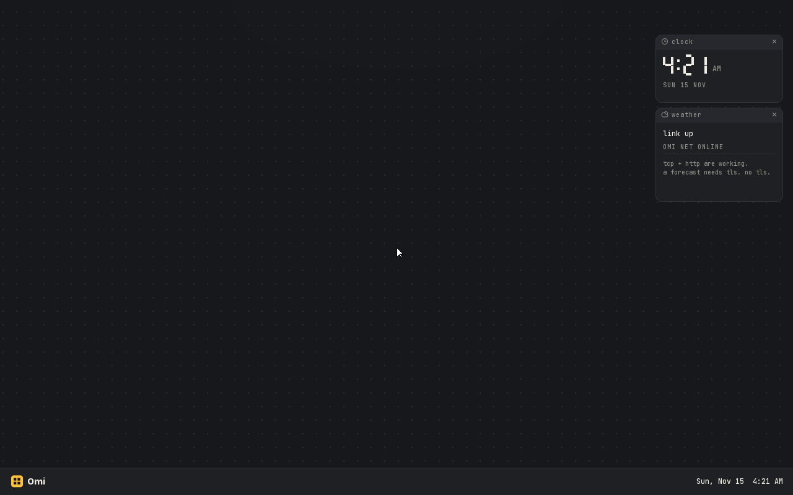

# Omi

A 64-bit operating system that boots on real hardware and runs programs in ring 3
with a real libc. Monolithic kernel, own drivers, own compositor, no Linux
underneath.

Forked from [vib-OS](https://github.com/viralcode/vib-OS) (a UEFI demo with a
window manager); what happened since is below. This tree is the whole OS: 46,846
lines of first-party kernel, 2,918 lines of user-mode programs, plus vendored
BearSSL and Gumbo.



## What it does

**Boots.** UEFI and legacy BIOS from one hybrid ISO, on QEMU and from a USB stick
in a real machine. Limine hands over the framebuffer and a list of boot modules;
the kernel brings up its own GDT/IDT, paging and heap, then starts the first
process.

**Runs a desktop.** Compositor with double buffering, draggable and resizable
windows, a bottom taskbar and a magnification dock, wallpapers decoded from JPEG
at boot, midnight theme by default. Widgets: sticky note, big clock, weather.
Apps drawn by the kernel shell: calculator, notes, media player, file manager,
task manager (live process count), and Omi Net - a browser with its own HTML
parsing (Gumbo) and image decoding.

**Talks to the network.** e1000 driver, ARP, IPv4, ICMP, UDP, TCP with a real state
machine and retransmission, a DNS resolver, and an HTTP client. The compositor
uses that stack to fetch and render remote images.

**Runs real programs.** An ELF loader with a 36-syscall native ABI, and enough of
the Linux ABI on top that static musl binaries work unmodified: `mmap`, `fork`,
`execve`, pipes, `epoll`, `memfd`, shared libraries, `clock_gettime`, futexes,
threads. BSD sockets (41/42/44/45/46/47/48/49/50/51/54/55 and 318) are implemented
so that a TLS stack can exist in user mode.

**TLS in user space, not the kernel.** `tlsget` links BearSSL against that socket
ABI and completes real handshakes with certificate-chain and hostname
verification; the kernel never sees a key.

**Windows whose pixels belong to the process.** A ring-3 window can map a surface,
write `0x00RRGGBB` words straight into it, and present a damage rectangle. The
kernel owns the frames and the placement; the compositor copies rows, with no
scaling and no resampling, so a surface pixel is a screen pixel.

**Audio.** HDA driver, and an MP3 decoder in the media player.

## What it doesn't do yet

- **No disk.** There is no ATA or NVMe driver and no writable filesystem. What the
  OS can read is what the bootloader loaded into memory, presented through a VFS.
- **One core.** No SMP: the kernel runs on the CPU the firmware started it on.
- **No GPU.** Every pixel is composed on the CPU.
- **Surfaces are small and few.** Four at a time, up to 620x420 each. Damage
  rectangles are tracked and counted, but the compositor rebuilds the scene from
  the wallpaper every frame, so the copy still covers the whole client rect.
- **Omi Net is a reader, not a browser.** HTML and images; no JavaScript.
- **Drivers are device-specific.** Tested on QEMU's q35 and on one physical
  machine. A different NIC or audio codec is unsupported, not merely untested.

## Build

Needs clang/LLD, xorriso, and QEMU for testing. Limine 8.6.0 is downloaded on the
first build.

```bash
sudo apt install clang lld xorriso qemu-system-x86
make                 # -> omi.iso
```

## Run

```bash
make run             # QEMU, UEFI
make run-bios        # QEMU, legacy BIOS
```

By hand, with the serial log in a file - how it is tested here, with no display:

```bash
qemu-system-x86_64 -M q35 -m 512M -cdrom omi.iso -boot d \
    -display none -serial file:serial.log \
    -netdev user,id=n0 -device e1000,netdev=n0
```

On a machine: write the ISO to a USB stick (`dd if=omi.iso of=/dev/sdX bs=4M`) and
boot it in UEFI or legacy mode.

## What proves it

Everything above is the output of a program that runs on the ISO at boot, not a
description of intent. A stock boot prints 217 individual pass lines (`[tag] ok`
in the serial log) and these numbered tallies:

| program | result | what it covers |
|---|---|---|
| `surftest` | 10/10 | surface mapping, present, damage, refusals |
| `omirender` | 12/12 | glyphs, wrap, clipping and blending in a ring-3 rasteriser |
| `surfexit` | — | a window and its surface are reaped when the process exits |
| `ominet` | 19/19 | TLS, HTML parsing, layout and painting in a ring-3 process |
| `tlsget` | 7/7 | real TLS handshakes from ring 3 |
| `socktest` | 20/20 | musl's `socket`/`connect`/`send` over the BSD ABI |
| `linux3` | 27/27 | Linux syscall surface |
| `pipe` / `pipe3` | 37/37, 30/30 | pipes, blocking, EOF, teardown |
| `maptest` | 24/24 | file-backed `MAP_PRIVATE`, `MAP_FIXED`, `PROT_NONE` guards |
| `epolltest` | 24/24 | `epoll` add/mod/del/wait |
| `memfdtest` | 23/23 | `memfd_create` and sealing |
| `modtest` | 15/15 | loading a module from the boot medium |
| `dyntest` | 14/14 | shared libraries and the dynamic linker |
| `lives` | 8/8 | process lifetime and reaping |
| `exectest` | 7/7 | `execve`, arguments, descriptor survival |

The screen is checked from outside the OS, because a program cannot see its own
pixels: a QEMU `screendump` of the running system is parsed and the exact
coordinates compared (`surftest` and `omirender` print their geometry for this).
Its colour bars are four pixels wide on purpose - a blit shifted by one pixel, or
a downscale of one, does not survive that check.

The surface tests park in a blocking wait rather than exiting, so the dump is
taken with their windows alive; `ominet` fetches example.com over TLS and paints
the page it received, and `surfexit` is the opposite test, filling a window
with a colour nothing else uses and returning from `main` immediately. Nothing of
that colour is left on screen afterwards, which is how the reaping is checked.

## Layout

```
kernel/
├── boot/        Limine entry, boot modules
├── drivers/     framebuffer, ps2, usb (ehci/xhci/hid), e1000, hda, acpi, pci
├── fs/          VFS, descriptors, pipes, sockets, epoll
├── gui/         compositor, shell apps, Omi Net, fonts, icons
├── mm/          paging, heap, copy-on-write
├── net/         TCP, DNS, HTTP
├── ring3.c      ELF loader, native syscalls, Linux ABI, surfaces
├── lib/         BearSSL, Gumbo, string
└── user/        the first process
userland/        programs that run in ring 3 (built with musl-gcc)
limine.conf      bootloader config
Makefile         build
```

## Origin

Forked from `viralcode/vib-OS`, which provided the UEFI entry, framebuffer, JPEG
wallpapers and a first window manager. Everything above concerning processes,
networking, TLS, audio and surfaces is not from there.